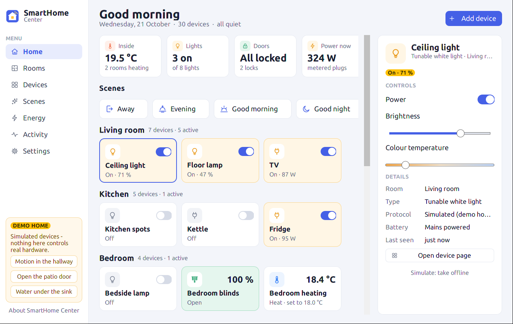
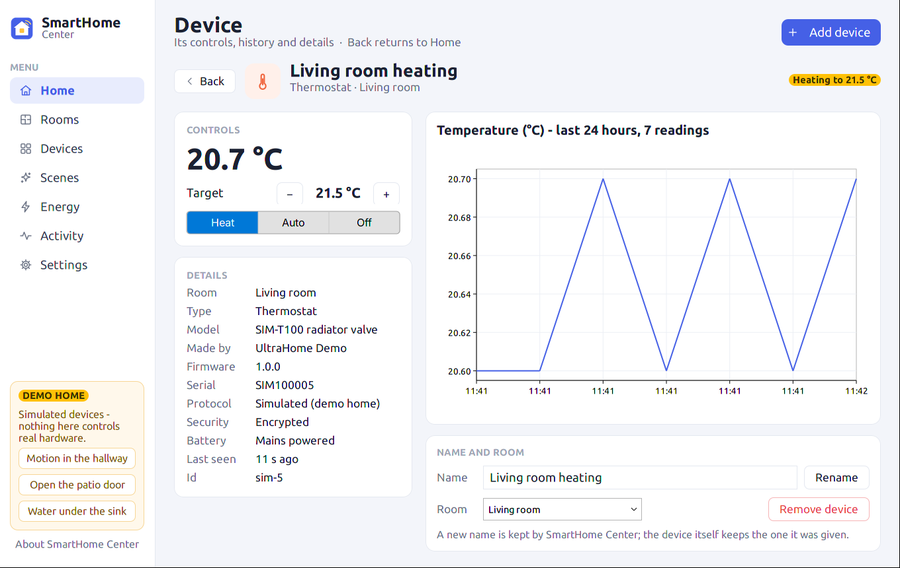
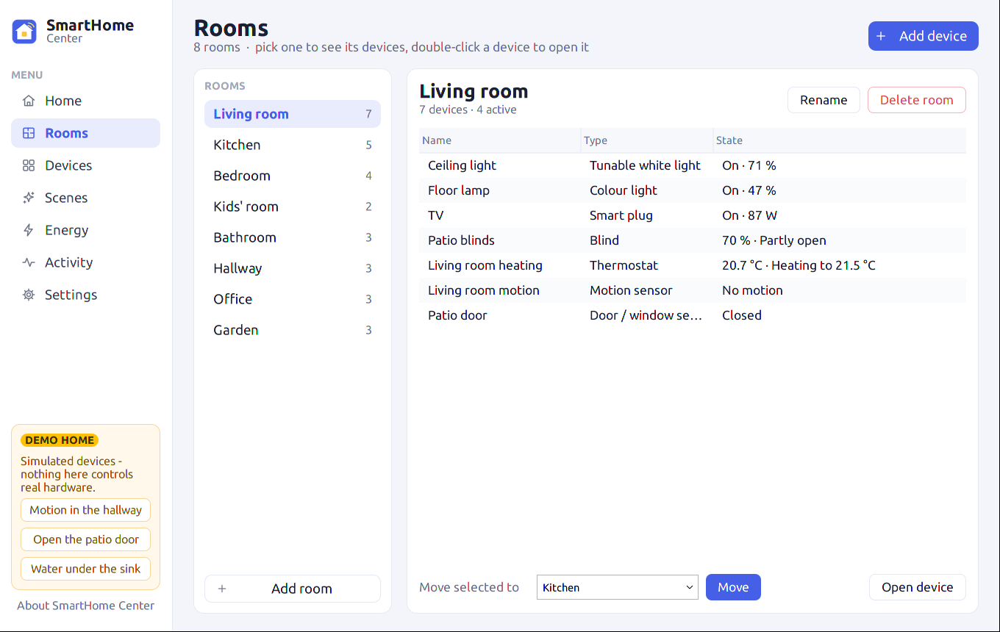
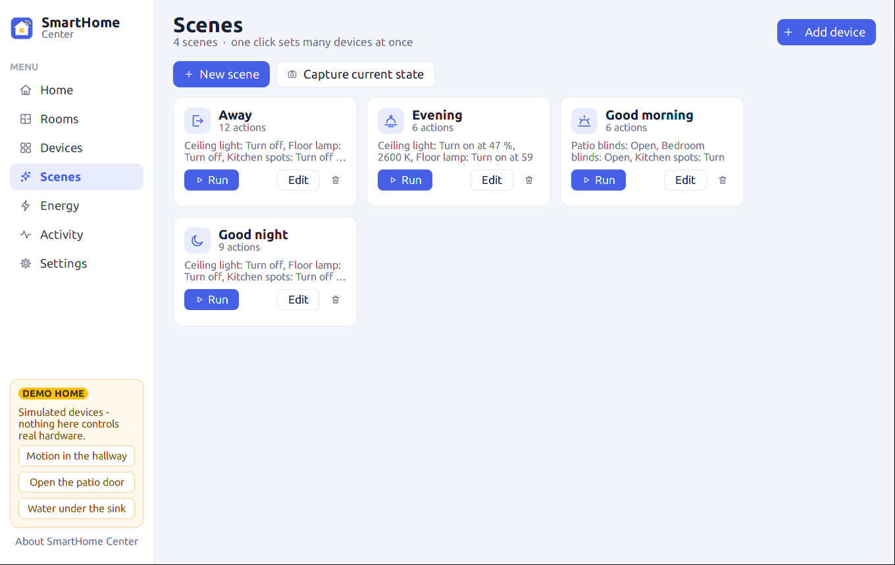
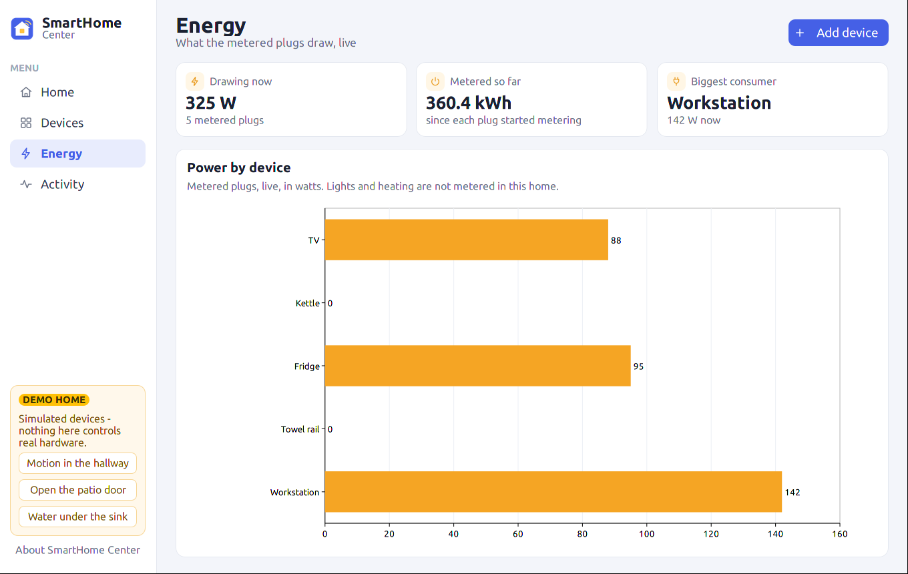

# SmartHome Center

The home control window on the SmartHome module: every room and device,
the scenes, the power drawn and what happened, in one window. It talks to
the home through `SmartHomeAPI` alone, so whatever radio the module drives -
Matter, Thread, Zigbee, Z-Wave, KNX - looks the same here. With no radio
enabled it opens the module's **simulated demo home** (30 devices in 8
rooms) and says so.

The design behind it:
[`Docs/Research/SmartHomeCenterDesignProposal.md`](../../Docs/Research/SmartHomeCenterDesignProposal.md).
The module, its backends and what each has been verified against:
[`SmartHome/STATUS.md`](../../SmartHome/STATUS.md).
Changelog and version: [`Docs/SmartHomeCenter/CHANGELOG.md`](../../Docs/SmartHomeCenter/CHANGELOG.md).

## The window











| Page | What it shows |
|---|---|
| **Home** | Inside temperature, lights on, locks, power now; the home's scenes; every room with a tile per device (a switch on the tile for whatever switches, the reading for whatever measures); the selected device's controls on the right. A leak or smoke alarm puts a red banner on top. |
| **Rooms** | The rooms with their device counts, the chosen room's devices. Add, rename and delete rooms; move a device to another room. |
| **Devices** | The whole home as a table: room, type, state, battery, power, protocol, last seen. Double-click a row to open the device. |
| **Device** | One device: its controls, every detail, its last 24 hours of readings as a chart, its name, room and removal. Opens from the inspector, Devices and Rooms. |
| **Scenes** | A card per scene (run, edit, delete), an editor for the actions, and *Capture current state*. |
| **Energy** | The metered plugs, live: a bar per plug drawing power, biggest first (idle plugs are left out and counted), and what each has metered so far. |
| **Activity** | What happened since the window opened, newest first: switches, locks, sensors, scenes, automations, pairing. |
| **Settings** | Where the home is (for sunrise and sunset), the data file and a backup of it, the radios this build carries. |

The first start of a home opens *Getting started*: welcome, location, rooms
to tick, radios.

Tiles take the colour of what the device is doing: amber for light and
power, coral for heating, green for an open lock or blind, blue for a sensor
reporting, red for an alarm or a device that stopped answering.

## Layout

| Path | What is in it |
|---|---|
| `ui/SmartHomeCenterModel.*` | What a device and the home look like to a person, from `SmartHomeAPI` alone: the state line, the icon, active / alert, the summary figures, the `--list` text. No UI types. |
| `ui/SmartHomeCenterCli.*` | The command-line actions (`--list`, `--set`, `--scene`, `--history`, `--log`), returning their text and exit code; main() and the test call the same functions. No UI types. |
| `ui/SmartHomeCenterDemo.*` | The demo home's scenes and automations, seeded into an empty home. No UI types. |
| `ui/SmartHomeCenterPaths.*` | Where the store lives: the per-user data directory, `ULTRA/SmartHome/smarthome.db` (`smarthome-demo.db` for the demo home) |
| `ui/SmartHomeCenterStyle.*` | The palette, the tones per state, and the building blocks every page is made of |
| `ui/SmartHomeCenterControls.*` | A device's controls (switch, sliders, target and mode, lock, position), shared by the inspector and the Device page |
| `ui/SmartHomeCenterPages.h`, `ui/SmartHomeCenter*Page.cpp`, `ui/SmartHomeCenterFirstRun.cpp` | Rooms, Device, Scenes, Settings and Getting started, each a class over the `PageHost` the window implements |
| `ui/SmartHomeCenterWindow.*` | The window: navigation, header, Home, Devices, Energy and Activity, the tiles, the inspector, the demo panel |
| `main.cpp` | Bootstrap, starting the radios (or the demo home), the command line |
| `tests/SmartHomeCenterCliTest.cpp` | The command line on the demo home, headless (`BUILD_TESTS`) |
| `SmartHomeCenter.desktop` | The freedesktop shortcut; `make install` places it with the app icon (`media/appicon/SmartHomeCenter.png` / `.svg`) |

Icons are `media/icons/smarthome/*.svg`: white line drawings the window
tints per state, so one file serves every colour.

Nothing is painted by hand: tiles and figures are containers of labels,
images, switches and badges; the controls use the framework's slider,
segmented control and buttons; names are `UltraCanvasTextInput`s, rooms
`UltraCanvasDropdown`s, the tables `UltraCanvasListView`s; a device's
history is an `UltraCanvasLineChartElement` and the Energy page an
`UltraCanvasBarChartElement` in its horizontal orientation; the backup goes
through `UltraCanvasFileLoader`'s Save dialog.

SmartHomeAPI reports changes on the thread that caused them. The window's
callbacks only note which device changed; a UI timer reads those devices
back four times a second and updates their tiles in place.

## Command line

```
SmartHomeCenter                       # the window
SmartHomeCenter --demo                # the window, on the demo home even if a radio works
SmartHomeCenter --page rooms          # open on a page: home, rooms, devices, scenes, energy,
                                      #   activity, settings, device (with --select)
SmartHomeCenter --select "Front door" # open with a device selected
SmartHomeCenter --first-run           # open on Getting started
SmartHomeCenter --trigger "Under-sink leak sensor"   # demo home: stage a sensor event

SmartHomeCenter --list [--csv]                        # the home, room by room
SmartHomeCenter --set "Kitchen spots" brightness=40   # on, brightness, colorTemp, target,
                                                      #   mode, locked, position
SmartHomeCenter --scene "Good night"                  # by name or id
SmartHomeCenter --history "Living room heating" --since 24h [--csv]
SmartHomeCenter --log --since 1h
```

The actions start the home, do one thing and exit (0 done, 1 bad input or
not found, 2 the device refused). They act on the home this process starts:
while the window holds a radio, a second process cannot open it - the hub
service of phase 3 lifts that. CSV and the history's numbers are written
with a dot whatever the locale.

## Not yet

Phase 2 of the proposal: automations, energy per room and over time, the
network page, the pairing wizard's per-protocol steps, notifications, a
kiosk mode and a dark theme; and the `SmartHome/ui` widgets ported to
framework elements. Phase 3 is the hub service that keeps automations
running with the window closed.
